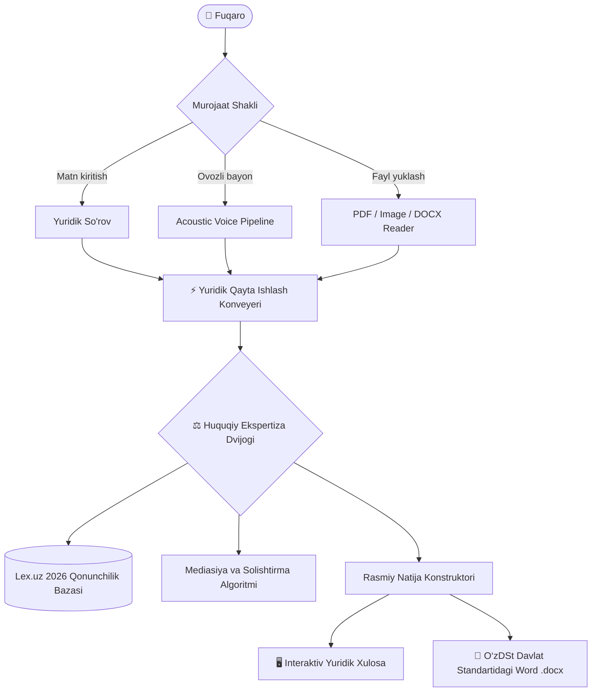

<div align="center">

# ⚖️ ADOLAT — O‘zbekiston Respublikasi Huquqiy Axborot va Sudgacha Mediasiya Milliy Portali

<p align="center">
  <a href="https://github.com/mansur20051512/lexHakaton">
    
  </a>
  <a href="https://github.com/mansur20051512/lexHakaton">
    
  </a>
  <a href="https://lex.uz">
    
  </a>
  <a href="https://lex.uz">
    
  </a>
  <a href="https://github.com/mansur20051512/lexHakaton/blob/main/LICENSE">
    
  </a>
</p>

<p align="center">
  <b>O‘zbekiston Respublikasi Adliya vazirligi standartlari va amaldagi Lex.uz qonunchilik bazasi asosida fuqarolarga sudgacha tinch, tezkor va qonuniy huquqiy yechim beruvchi milliy dasturiy majmua.</b>
</p>

</div>

---

## 🏛️ Tizimning Asosiy Vazifalari va Modullari

| Modul | Funktsional Vazifasi | Huquqiy Asos va Standartlar |
|:---|:---|:---|
| ⚖️ **Sudgacha Mediasiya va Foyda Kalkulyatori** | Fuqarolik va tijorat nizolarini sudga kirmasdan hal etish, sud (2–6 oy, 4% davlat boji) va mediasiya (3–7 kun, tejamkorlik) harajatlarini taqqoslash. | O‘zR «Mediasiya to‘g‘risida»gi Qonuni |
| 📑 **Yuridik Tahlil va Hujjat Konstruktori** | Muammoni amaldagi kodekslar (FK, MK, MJtK, SK, OK) bo'yicha tahlil qilish hamda davlat standarti talablaridagi rasmiy ariza/da'vo loyihasini yaratish. | O‘zDSt / GOST davlat ish yuritish standarti |
| 🏢 **Davlat Idoralariga Murojaat Konstruktori** | Vazirliklar, viloyat/shahar hokimliklari, kommunal idoralar va Xalq qabulxonasiga rasmiy ariza va shikoyatlarni avtomatlashtirilgan tartibda tuzish. | O‘zR «Jismoniy va yuridik shaxslarning murojaatlari to‘g‘risida»gi Qonuni (O‘RQ-445) |
| 📋 **Notariat Gidi va Bojlar Hisoblagichi** | Meros huquqi, ko'chmas mulk oldi-sotdisi, hadya va avtotransport ishonchnomalari bo'yicha hujjatlar ro'yxati va davlat boji miqdorlarini hisoblash. | «Davlat boji to‘g‘risida»gi Qonun, My.gov.uz va E-notarius |
| 📄 **Universal Hujjat va Ovoz Analizatori** | Fuqarolar tomonidan kiritilgan matn, audio xabarlar hamda PDF, JPG, PNG, DOCX hujjatlaridan yuridik rekvizitlarni ajratib oluvchi modul. | Web Speech API, PyMuPDF, python-docx |
| 🌐 **To‘liq Uch Tillilik (Trilingual Engine)** | O‘zbekcha (Lotin), Ўзбекча (Кирилл) va Русский tillarida 100% sinxron ishlash va har bir tilda professional yuridik uslubda hujjat tayyorlash. | 0 ta tarjimasiz qolgan termin |

---

## 📅 2026-yilgi Amaldagi Qonunchilik Standartlari

Platforma O‘zbekiston Respublikasining 2026-yilgi eng so'nggi normativ-huquqiy bazasiga 100% moslashtirilgan:
1. **BHM (Bazaviy hisoblash miqdori):** **440 000 so‘m** etib belgilangan (barcha davlat bojlari, ma'muriy jarimalar va to'lovlar eng so'nggi stavkalarda hisoblanadi).
2. **15 kunlik 50% imtiyozli chegirma:** MJtK 332-1-moddasi talablariga muvofiq, ma'muriy jarimalarni 15 kun ichida to'laganda 50% tejash imkoniyati ko'rsatiladi.
3. **Yangi Mehnat Kodeksi:** 253 va 269-moddalar bo'yicha kechiktirilgan oylik maoshlar uchun Markaziy Bankning qayta moliyalash stavkasi bo'yicha qat'iy kompensatsiya hisobi.

---

## 🏗️ Dasturiy Arxitektura



---

## 📄 Davlat Ish Yuritish Standarti (O‘zDSt)

Generatsiya qilinadigan barcha `.docx` formatidagi hujjatlar O'zbekiston Respublikasining rasmiy idoraviy standartlariga qat'iy mos:
- **Format:** A4, Times New Roman, 14pt shrift, 1.15 interval.
- **Hoshiyalar:** Chapdan 30mm, o'ngdan 15mm, yuqori va pastdan 20mm.
- **Rekvizitlar:** O'ng burchakda rasmiy "Kimga" va "Kimdan", markazda hujjat nomi, matnda asoslangan qonun moddalari, oxirida sana va imzo joyi.

---

## 🔒 Xavfsizlik va Maxfiylik

> [!IMPORTANT]
> - Ushbu repozitoriyda foydalanuvchilarning shaxsiy ma'lumotlari yoki maxfiy tizim kalitlari saqlanmaydi.
> - Barcha tizim sozlamalari `.env` fayli orqali boshqariladi va `.gitignore` orqali to'liq himoyalangan.

---

## 🚀 O'rnatish va Ishga Tushirish

### 1. Repozitoriydan nusxa olish:
```bash
git clone https://github.com/mansur20051512/lexHakaton.git
cd lexHakaton
```

### 2. Bog'liqliklarni o'rnatish:
```bash
python -m venv venv

# Windows:
venv\Scripts\activate

# Linux / MacOS:
source venv/bin/activate

pip install -r requirements.txt
```

### 3. Konfiguratsiyani tayyorlash:
```bash
copy .env.example .env
```

### 4. Ma'lumotlar bazasini yangilash va serverni ishga tushirish:
```bash
python manage.py makemigrations legal
python manage.py migrate
python manage.py runserver
```

Brauzerda oching: **`http://127.0.0.1:8000/`**

---

## 👨‍💻 Muallif

**Mansur Akboyev** — [GitHub Profili](https://github.com/mansur20051512)  
🏛️ Toshkent Axborot Texnologiyalari Universiteti (TATU)  
🏆 *O‘zbekiston Respublikasi Adliya vazirligi LegalTech xakatoni uchun maxsus ishlab chiqilgan.*
