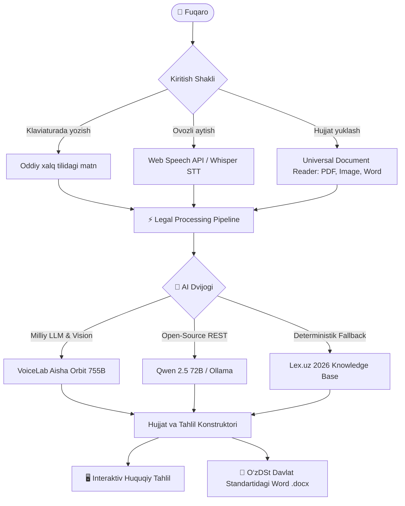

<div align="center">

<!-- Header Banner -->


<p align="center">
  <a href="https://github.com/mansur20051512/lexHakaton">
    
  </a>
  <a href="https://github.com/mansur20051512/lexHakaton">
    
  </a>
  <a href="https://voicelab.uz">
    
  </a>
  <a href="https://lex.uz">
    
  </a>
  <a href="https://github.com/mansur20051512/lexHakaton/blob/main/LICENSE">
    
  </a>
</p>

<p align="center">
  <b>⚖️ O‘zbekiston Respublikasi Adliya vazirligi standartlari va amaldagi Lex.uz qonunchiligi asosida fuqarolarga sudgacha tinch, tez, arzon va qonuniy huquqiy yordam ko‘rsatuvchi milliy sun'iy intellekt (LegalTech) tizimi.</b>
</p>

</div>

---

## 🌟 Asosiy Imkoniyatlar va Modullar

| Modul | Funktsional Tavsifi | Asosiy Qonunchilik / Standart |
|:---|:---|:---|
| 🏛️ **Yuridik Tahlil & Hujjat Generatori** | Fuqaroning muammosini tahlil qilib, amaldagi kodekslar (FK, MK, MJtK, SK, OK) bo'yicha batafsil huquqiy xulosa va davlat ish yuritish talabidagi Word (.docx) tayyorlaydi. | O‘zDSt / GOST standartlari, Fuqarolik va Mehnat kodekslari |
| ⚖️ **Mediasiya & Foyda Kalkulyatori** | Sud (2–6 oy, 4% davlat boji, advokat xarajatlari) va Mediasiya (3–7 kun, 80%+ ijobiy kelishuv, 0 boj) taqqoslamasini beradi. | O‘zR «Mediasiya to‘g‘risida»gi Qonuni |
| 🏢 **Murojaat Konstruktori** | Vazirliklar, hokimiyatlar, kommunal idoralar va Xalq qabulxonasiga rasmiy ariza va shikoyat loyihalarini shakllantiradi. | O‘zR «Murojaatlar to‘g‘risida»gi Qonuni (O‘RQ-445) |
| 📑 **Notariat Gidi va Bojlar** | Meros, oldi-sotdi, hadya, ishonchnomalar bo'yicha talab etiladigan hujjatlar va davlat boji stavkalarini aniq hisoblab beradi. | «Davlat boji to‘g‘risida»gi Qonun, My.gov.uz & E-notarius |
| 🎙️ **Multimodal Qabul (Vision & Ovoz)** | PDF hujjatlar, fotosuratlar (JPG/PNG), Word fayllar hamda real vaqtli ovozli xabarlarni tahlil qilish imkoniyati. | Web Speech API, PyMuPDF, EasyOCR |
| 🌐 **100% Ko‘p Tillilik (Trilingual i18n)** | O‘zbekcha (Lotin), Ўзбекча (Кирилл) va Русский tillari o'rtasida to'liq sinxron va mukammal moslashuv. | 0 ta tarjimasiz qolgan matn |

---

## 📅 2026-yilgi Qonunchilik Standartlari

Platforma O'zbekiston Respublikasining 2026-yilgi eng so'nggi normativ-huquqiy hujjatlari asosida ishlaydi:
- **1 BHM (Bazaviy hisoblash miqdori):** **440 000 so‘m** (barcha bojlar, jarimalar va to'lovlar ushbu ko'rsatkichda hisoblanadi).
- **15 kunlik 50% imtiyozli chegirma:** MJtK 332-1-moddasiga binoan barcha ma'muriy jarimalar (masalan, 440 000 so'mlik jarima 15 kun ichida 220 000 so'm) avtomatik hisoblanib, fuqaroga tejamkor yo'l ko'rsatiladi.
- **Yangi Mehnat Kodeksi:** 253 va 269-moddalar bo'yicha kechiktirilgan oylik maoshlar uchun kompensatsiya (MB qayta moliyalash stavkasi) hisobi.

---

## 🏗️ Tizim Arxitekturasi



---

## 🔒 Xavfsizlik va Maxfiylik Kafolati

> [!IMPORTANT]
> - Ushbu repozitoriyda hech qanday shaxsiy API kalitlar yoki xavfsizlik tokenlari saqlanmaydi.
> - Barcha API kalitlar faqat lokal `.env` faylida saqlanadi va `.gitignore` orqali to'liq himoyalangan.
> - Fuqarolarning shaxsiy murojaat ma'lumotlari serverda uchinchi shaxslarga uzatilmaydi.

---

## 🚀 O'rnatish va Ishga Tushirish

### 1. Repozitoriydan nusxa olish:
```bash
git clone https://github.com/mansur20051512/lexHakaton.git
cd lexHakaton
```

### 2. Virtual muhit yaratish va bog'liqliklarni o'rnatish:
```bash
python -m venv venv

# Windows:
venv\Scripts\activate

# Linux / MacOS:
source venv/bin/activate

pip install -r requirements.txt
```

### 3. Konfiguratsiya faylini sozlash:
`.env.example` dan nusxa olib, `.env` faylini hosil qiling va o'z kalitingizni kiriting:
```bash
copy .env.example .env
```

```env
SECRET_KEY=your_django_secret_key
DEBUG=True
VOICE_MODE=voicelab
VOICELAB_API_KEY=your_voicelab_key_here
VOICELAB_LLM_MODEL=aisha-orbit
```

### 4. Ma'lumotlar bazasini yangilash:
```bash
python manage.py makemigrations legal
python manage.py migrate
```

### 5. Serverni ishga tushirish:
```bash
python manage.py runserver
```

Brauzerda oching: **`http://127.0.0.1:8000/`**

---

## 👨‍💻 Muallif

<div align="center">

**Mansur Akboyev** — [GitHub Profili](https://github.com/mansur20051512)  
🏛️ Toshkent Axborot Texnologiyalari Universiteti (TATU / TUIT)  
🏆 *O‘zbekiston Respublikasi Milliy LegalTech Xakatoni uchun maxsus ishlab chiqilgan.*

<br/>

<!-- Footer Waving Banner -->


</div>
